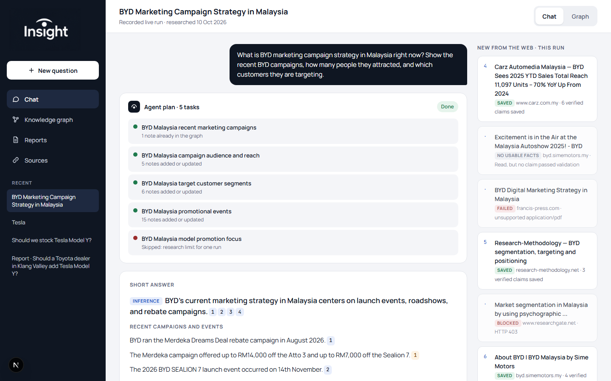
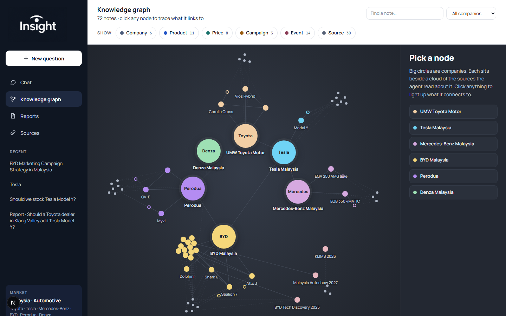
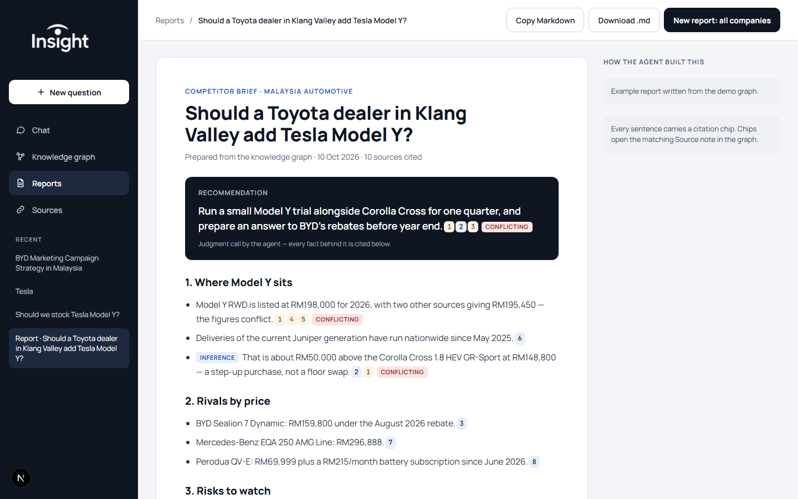
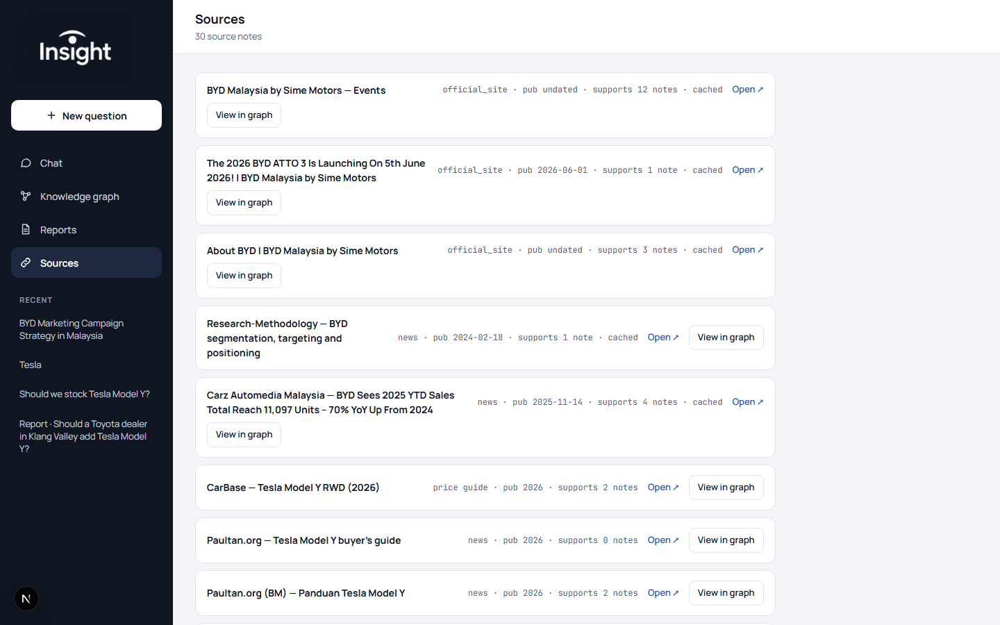

# Insight — Competitor Intelligence Graph Agent

**Live demo:** https://insight-app-teal.vercel.app

A car dealership owner asks anything ("Tesla", "How should we compete on EV pricing?").
The agent plans tasks, checks the knowledge graph, researches public sources for gaps,
saves atomic linked notes, and answers with a citation on every sentence.

Demo market: Malaysian automotive (Toyota, Tesla, Mercedes-Benz, BYD, Perodua).

## Interface

### Chat — ask, plan, answer
Ask anything in plain language. The agent shows its plan, reads pages it found, and answers with chips on every sentence that open the underlying source in the graph.



### Knowledge graph — see every link
Every note the agent wrote is on the graph: big circles are companies, the cloud around each one is the sources that mention them. Click a node to trace what it links to, or filter by note type.



### Reports — competitor briefs on demand
"New report: all companies" writes a one-page brief with a recommendation, one section per brand, and a "Risks to watch" section. Conflicting claims are flagged inline, not hidden. Copy Markdown or download as `.md`.



### Sources — every claim is traceable
Every source the agent read is listed here with its publication date, how many notes it supports, and a direct "View in graph" jump into where its claims appear.



## Run locally

```bash
npm install
cp .env.example .env.local   # add DEEPSEEK_API_KEY and TAVILY_API_KEY
npm run dev                  # http://localhost:3000
npm run check                # citation, snippet and duplicate checks
```

Without keys the demo graph, example answer and example report still work; asking a new
question shows a "key not set" message.

## How it works

Models: DeepSeek (`deepseek-v4-pro` for planning, extraction and answers; `deepseek-flash` for validation)
through its OpenAI-compatible API with JSON output. Search: Tavily. Without `TAVILY_API_KEY` the agent
still answers from the graph but marks research tasks as failed.

`POST /api/ask` streams Server-Sent Events while the pipeline runs (`lib/agent.ts`):

1. **Planner** — request → 2–6 tasks (company, note type, search query).
2. **Retriever** — keyword search over notes + link expansion (`lib/retrieve.ts`, minisearch).
3. **Researcher** — for uncovered tasks: Tavily web search, then direct page fetch that honours
   robots.txt, skips LinkedIn/social/login sites, and times out (`lib/web.ts`).
4. **Extractor** — page text → candidate notes, claims, links (structured JSON).
5. **Validator** — a claim is kept only if its evidence snippet is found in the fetched text
   and a second DeepSeek call agrees the snippet supports it.
6. **Graph writer** — merges into existing notes instead of duplicating; conflicting prices are
   both kept and marked; notes with zero claims are not saved (`lib/store.ts`).
7. **Answerer** — writes only from retrieved claims; uncited sentences are dropped.

Storage is SQLite (`better-sqlite3`). Search results, pages and model calls are cached;
`DEMO_MODE=1` answers from the cache only. `GET /api/export` exports all notes as Markdown
with `[[wikilinks]]`.